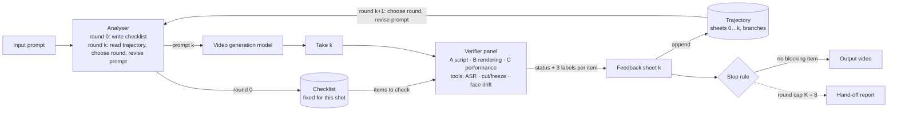

# Auditing the Loop — design document

**Auditing the Loop: an agentic verification harness for video generation.**
Date: 2026-11-07. Implementation plan: `PLAN.md`. Audience: the author, and a writing agent that turns this document plus experiment outputs into the midway report (3–4 pages, ICLR style; sections Research Questions, Environment & Data, Methods, Summary of Progress, References).

Related files: the earlier design `../../avharness/docs/DESIGN_v2.md` (Chinese, 2026-10-21), the methods survey `../../avharness/docs/research/methods_to_build_on_2026-11-07.md`, the midway draft `../../midway/midway_report.tex` + `midway_references.bib` (25 verified entries), and the dimensions report `../../../reports/AI 视频评估维度全景.md` (111 evaluation dimensions, 52 benchmarks).

---

## 1. Summary

Auditing the Loop runs between a video-generation model and delivery. The input is one prompt for one short-drama shot: one speaking character, one spoken line, one or two actions, sometimes a sound effect, an acting cue, and whatever other characters the script places in the scene. The system generates a take, checks it against a checklist written from the prompt, labels every problem with three labels (severity, uncertainty state, fixability), revises the prompt, and generates again. It keeps the full trajectory of rounds, so the revision step can go back to an earlier round and branch from there. It stops when the stop rule says that no blocking problem remains, or when the round cap is reached; then it hands the best take and the trajectory to a human. No human is needed inside the loop.

We chose short drama because it is the video-generation use case with a working business model, and because its shots have explicit requirements (line, action, emotion) that can be checked.

**Research questions.**
- RQ1 (verifier validity): does a checklist-driven panel of specialist verifiers, with uncertainty derived from agreement rather than from a model-reported probability, judge generated short-drama shots more accurately than a single VLM judge, at comparable cost?
- RQ2 (loop usefulness): do the three labels and the trajectory raise the share of shots that pass, within a bounded number of rounds and dollars, with few hand-offs?
- RQ3 (loop stability): how often does a revision fix one problem and break another, and does trajectory-aware revision (branching from an earlier round) reduce this?

---

## 2. Positioning

| Work | What it does | Difference |
|---|---|---|
| VISTA (Long et al. 2025, arXiv 2510.15831) | test-time self-improving video generation agent; no public code | Auditing the Loop keeps a persistent trajectory with branching, three labels per problem, and a rule-based stop rule |
| DramaAgent (Huang et al. 2026, arXiv 2610.00097) | agentic storytelling video generation; candidates = 3, repair rounds = 2, frames-only judge | Auditing the Loop hears the audio track, checks dialogue with ASR, and separates verification from planning |
| VideoArgus (Zeng et al. 2026, arXiv 2608.05485) | agentic rubric-grounded evaluation of generated video | Auditing the Loop closes the loop and labels fixability |
| AVGen-Bench (Zhou et al., ICML 2026) | task-driven audio-video benchmark with Whisper / SyncNet tools | tools reused as evidence; Auditing the Loop is per-shot acceptance, not a benchmark |
| DSG / TIFA / ETVA (Cho 2024; Hu 2023; Guan 2025) | decompose a prompt into atomic questions | the checklist is the same idea, with MUST / MUST NOT / PREMISE parts and fixed per instance |
| Trust-or-Escalate, SCOPE, Judge-Retrieve-or-Abstain (Jung 2024; Badshah 2026) | selective LLM judging with abstention | the uncertainty state is operational (confident / uncertain / not observable), computed from order swap, a second model family and tool agreement |
| Replacing Judges with Juries (Verga et al. 2024) | panel of diverse models | the second model family is one of the agreement signals |
| Who Validates the Validators / EvalGen (Shankar et al., UIST 2024) | criteria drift when humans grade LLM outputs | checklist fixed at round 0; checklist template audited once on 30 shots |
| Don't Read the Log (Xu 2026, arXiv 2609.28564) | execution traces contaminate verifiers in video-generation agents | rule: the verifier panel never sees the trajectory |
| HALLELUAI (Sakpal et al. 2026), ArtiVidRM (Li et al. 2026) | hallucination-aware I2V system; artifact-as-rubric reward model | related evidence types for the B-family checks |

Full survey with 25 candidates: `../../avharness/docs/research/methods_to_build_on_2026-11-07.md`.

---

## 3. System

### 3.1 Components

| Component | Role | Model / tool |
|---|---|---|
| **Analyser** | round 0: writes the checklist from the prompt; round k ≥ 1: reads the whole trajectory, decides which round to branch from and how to revise the prompt | google/gemini-4-argon, text only |
| **Checklist** | the items to check for this instance: MUST (explicit requirements), MUST NOT (negatives: the cast the script defines, no unscripted events, no subtitles), PREMISE (facts implied by the script); each item maps to one check id (§4) with a priority and an evidence type; fixed for the whole loop | — |
| **Video generation model** | produces take k from prompt k | bytedance/seedance-2.0 (OpenRouter), 480p, 9:16, 8 s, audio on |
| **Verifier panel** | three specialist verifiers, one per family (A script fidelity, B rendering integrity, C dramatic performance); each is one call with the take and that family's checklist items; the three calls run in parallel | google/gemini-4-argon, which hears the audio track; OpenRouter samples the video at 1 frame per second |
| **Evidence tools** | independent evidence next to the model: ASR (transcript, language, WER), ffprobe (duration, resolution, audio track), ffmpeg scene and freeze detection | mlx-whisper on the Mac; ffmpeg/ffprobe |
| **Feedback sheet** | per round: one row per checklist item with status, three labels, evidence time span, cost; plus the round index | rules only |
| **Trajectory** | per shot: every round's prompt, feedback sheet, which round it branched from, the Analyser's rationale; stored as JSON | — |
| **Stop rule** | release if no item is blocking (§3.3); otherwise continue; at the round cap, hand off | rules only |

### 3.2 Loop

```
checklist  = analyser.write_checklist(prompt)          # fixed afterwards
trajectory = Trajectory(shot_id)
prompt_k   = prompt
for k in range(K):                                      # K = 8
    take_k  = backend.generate(prompt_k)
    sheet_k = panel.verify(take_k, checklist)           # the panel never sees the trajectory
    trajectory.append(k, prompt_k, sheet_k, branched_from)
    if stop_rule(sheet_k):                              return Output(take_k, trajectory)
    plan     = analyser.revise(checklist, trajectory)   # branch_from, revised_prompt, rationale, targets
    assert_script_spans_unchanged(plan.revised_prompt)  # rule 2
    prompt_k, branched_from = plan.revised_prompt, plan.branch_from
return HandOff(analyser.pick_best(trajectory), trajectory)
```

The Analyser receives the full trajectory and reasons about where to continue and what to change. The code gives it no scoring function and does not pick the parent round for it.

**Two rules enforced in code.**
1. The verifier panel never sees the trajectory, the Analyser's rationale, or earlier verdicts. Verifiers that read execution traces are contaminated (Xu 2026).
2. The Analyser may not change the script. The verbatim spans (setting, character line, actions, speaker cue, parenthetical, dialogue line) must remain in every revised prompt; only guidance sentences may be added or removed (e.g. "speaks English", "no other person in frame"). Enforced by substring checks.

### 3.3 Stop rule and hand-off

A **blocking** item is an error we believe: severity = error and uncertainty state ∈ {confident, uncertain}. After each round: no blocking item → release the take; at least one blocking item is prompt- or retry-fixable → next round; every blocking item is backend-limited → hand off to a human, because the system has concluded that neither a prompt change nor a retry will fix it and releasing would deliver a known defect. Warnings, info and not-observable items go into the report and never block.

Round cap K = 8. At the cap, the Analyser names the best round from the trajectory; the system outputs that take plus the trajectory as a hand-off report. This is the only hand-off branch for now. The hand-off rate is a reported metric.

### 3.4 Framework figure: drawing guide

Base: the author's sketch of 2026-11-07. It has, left to right, input prompt → Analyser → checklist; Analyser → video generation model → generated video → group of evaluation experts (which read the checklist) → feedback & todo memory; and a loop arrow on top from the memory back to the Analyser. Keep that reading order and keep the loop on top. The final figure adds the items below.

**Boxes and their exact labels** (use the terms of §3.1):

| box | label text | shape |
|---|---|---|
| input | "Input prompt" | rounded box |
| Analyser | "Analyser" on line 1; line 2 "round 0: write checklist"; line 3 "round k: read trajectory, choose the round to continue from, revise prompt" | rounded box, the tone for agents and models |
| checklist | "Checklist (fixed for this shot)" with three small rows inside: MUST, MUST NOT, PREMISE | box with a double border = fixed object |
| generator | "Video generation model" | rounded box, agent/model tone |
| take | "Take k" | small box with a film-frame icon |
| panel | "Verifier panel": three person icons labelled A script fidelity, B rendering integrity, C dramatic performance; a tray under them labelled "tools: ASR · cut/freeze · face drift" | group box |
| feedback | "Feedback sheet k" drawn as a small table with three columns: severity, uncertainty, fixability | box |
| memory | "Trajectory" drawn as a stack of feedback sheets, one per round, with round numbers 0…k; one branch arrow from a later sheet back to an earlier one | stacked-sheets icon |
| stop rule | "Stop rule" | diamond |
| output | "Output video" | box |
| hand-off | "Hand-off report (round cap K = 8)" | box, dashed border |

**Arrows:**

| from → to | label | style |
|---|---|---|
| input → Analyser | — | solid |
| Analyser → checklist | "round 0" | solid |
| Analyser → generator | "prompt k" | solid |
| generator → take → panel | — | solid |
| checklist → panel | "items to check" | solid, from above |
| panel → feedback sheet | "status + 3 labels per item" | solid |
| feedback sheet → stop rule | — | solid |
| stop rule → output | "no blocking item" | solid |
| stop rule → hand-off | "round cap reached" | dashed |
| feedback sheet → memory | "append round k" | solid |
| memory → Analyser | "round k+1: choose the round to continue from, revise the prompt" | thick, drawn along the top as the loop |
| panel ⟂ memory | "does not read" | a short dashed line with a cross between the panel and the memory |

**Notation.** Two tones only: one for agents and models (Analyser, generator, panel), one for data objects (prompt, checklist, take, sheet, memory). Double border means "fixed during the loop" (checklist). Dashed means "exit at the cap" or "no data flow". Mark the round index k on the prompt, the take and the sheet, so the reader sees that one pass through the figure is one round. Keep box text to six words or fewer, except the Analyser.

**Caption (suggested).** "Auditing the Loop. The Analyser writes a checklist once, then the loop runs: generate take k, verify it against the checklist with three specialist verifiers and tools, record a feedback sheet with three labels per item, stop if no blocking item remains, otherwise the Analyser reads the whole trajectory, chooses the round to continue from, revises the prompt and generates again. At the round cap the best take and the trajectory are handed to a human."

Mermaid source as a starting point:



---

## 4. Checklist taxonomy

Evidence codes: **T** deterministic tool; **D** blind description followed by text entailment; **P** specialist verifier looks and listens; **T/P** tool first, model second. Priorities are defaults; the Analyser raises B1 when the script's action involves physics. Family names are listed under open decisions (§13).

**A. Script fidelity — does the take show what the prompt wrote?**

| id | check | question | evidence | priority |
|---|---|---|---|---|
| A1 | dialogue fidelity | is the line spoken in English, complete and verbatim | T (ASR: transcript, language, WER) | critical |
| A2 | action completion | does each written action happen, finish, in order | D + P | critical |
| A3 | required elements | do the written props, setting and sound effect appear | D + P | major |
| A4 | no extraneous content | everyone on screen is in the cast the Analyser read from the script; only the speaker speaks; no unscripted event changes the scene | D + P | critical (person outside the cast) / major |
| A5 | premise and relation logic | do background and relations match the premise (e.g. armies encircling one person must not fight each other) | D | major |
| A6 | framing | camera on the speaker, shot scale and vertical format as written | T/P | minor |

**B. Rendering integrity — is the picture and sound itself sound?**

| id | check | question | evidence | priority |
|---|---|---|---|---|
| B1 | physical plausibility | liquids, collisions, gravity behave | P | minor (raised when the action involves physics) |
| B2 | anatomy and artifacts | hands, faces, limbs normal; no morphing; no garbled text | P (zoom when needed) | major |
| B3 | identity continuity | same face, voice and clothing throughout | T/P (face-embedding drift + listening) | major |
| B4 | temporal continuity | no unintended cut, freeze, jump or loop | T (frame difference) + P | major |
| B5 | audio-visual sync | lips match speech; sound effects match events; the voice belongs to the person on screen | P | major |
| B6 | technical delivery | duration, resolution, aspect ratio, audio track present | T (ffprobe) | info; major if violated |
| B7 | on-screen text | no subtitles or watermarks | P | minor |

**C. Dramatic performance — is the scene acted as written?**

| id | check | question | evidence | priority |
|---|---|---|---|---|
| C1 | emotion class | matches the cue | P | major |
| C2 | emotion intensity | within the target interval; not over-acted | P (0–4 for face and voice) | major |
| C3 | transition timing | when a turn is scripted, does it happen at the right time | P | minor (only when scripted) |
| C4 | vocal delivery | pace, pauses and tone match the parenthetical | P | minor |
| C5 | tone and atmosphere | lighting, setting and mood match the premise | P | minor |
| C6 | aesthetics | composition and lighting quality | P | info (never blocks) |

Mapping to the earlier dimension list: A1–A6, B2–B5, C1–C3 are the 14 core dimensions; B1, B6, B7, C5, C6 are the 5 extended ones; the earlier 5 preflight checks are folded into B4 and B6.

---

## 5. The three labels

**Uncertainty state** (never a model-reported probability). Signals: the verifier's observability judgement for the item (seen clearly, partly seen, not observable) and, where a tool covers the item, whether the tool agrees.

| condition | state |
|---|---|
| the verifier says the clip cannot show the item | not_observable |
| a tool covers the item and agrees with the verifier | confident |
| a tool covers the item and disagrees | uncertain |
| no tool; the verifier saw the moment clearly and gave a definite answer | confident |
| no tool; partly seen, or the verifier itself says uncertain | uncertain |

Running each family twice with the item order swapped, or adding a second model family, would add agreement signals to this table; both were dropped on 2026-11-08 to keep the panel to three calls per take.

**Severity**

| status | priority | state | severity |
|---|---|---|---|
| fail | critical | confident or uncertain | error |
| fail | major | confident | error |
| fail | major | uncertain | warning |
| fail | minor | any | warning |
| any | any | not_observable | info (marked unverified) |
| pass | any | any | info |

**Fixability.** A prior table per check id (e.g. A1 wrong language → prompt_fixable; B2 hand artifact → retry_fixable; B5 lip sync → backend_limited), then revised by the trajectory: an item that still fails after two prompt revisions → backend_limited; an item that flips between pass and fail across rounds → retry_fixable. The prior table is revised once from the 30-shot pilot, then fixed.

---

## 6. Verifier panel details

1. **Three specialist calls** per take, one per family, to google/gemini-4-argon with the take (video and audio) and that family's items. Each call is told to watch and listen to the whole clip first, then answer every item with status (pass / fail / uncertain / not_applicable), visibility (seen_clearly / partially_seen / not_observable), one sentence of evidence with a time stamp, a time span, and for C items face and voice intensity on a 0–4 scale. The A brief states that an absent event is a fail, not uncertain, and that a named object must be that object (a clipboard is not a portfolio).
2. **Tools** answer A1 (whisper: language and word error rate), B4 (ffmpeg scene and freeze detection) and B6 (ffprobe). For A1 and B6 the tool's answer is the status; the verifier's answer only sets the uncertainty state.
3. **Parsing is strict**: a missing or malformed item triggers one retry with the error quoted, then the round fails loudly.
4. **Cost**: about $0.01 per take for the three calls (an 8 s clip is about 900 prompt tokens).

Earlier versions used two blind descriptions, a second model family, order-swapped runs, text entailment and re-inspects (19 calls per take). They were removed on 2026-11-08 because the design had not been agreed and the extra calls were hard to reason about; the agreement-based uncertainty signals they provided are listed in §5 as an option.

---

## 7. Data

### 7.1 Sources used

| Source | What it is | Licence | Peer review | Used |
|---|---|---|---|---|
| DramaBench (HF FutureMa/DramaBench; Ma, Huang, Lin, arXiv 2512.19012) | 1,103 English Fountain-format short-drama scripts (1,041 parsed locally) with dialogue, parentheticals, action lines | MIT on HF; the paper says the scripts come from an unpublished "english_short_drama_scripts_dataset" whose licence is not named | arXiv only; a companion ICLR 2026 ICBINB workshop poster | 22 of 30 shots |
| SEAM-Bench (HF Jackyqq/SEAM-Bench; Liu et al., arXiv 2608.22725) | one vertical drama "His Toyboy: The Billionaire's Trap", 23 English episode scripts + human-director storyboards (景别 / 拍摄角度 / 运镜) | CC BY-NC 4.0 | preprint | 3 of 30 shots; episodes 1, 2, 7, 8, 9 excluded (coercive sexual scenes) |
| FilmBench (HF skylenage/FilmBench; Wang et al., arXiv 2607.24241) | film-grade T2V prompts reverse-engineered from film clips; 1,869 one-quote segments extracted locally | Apache-2.0 | arXiv only | 5 of 30 shots |

Caveats for the report: none of the three sources is peer-reviewed as of 2026-11-07; DramaBench scripts carry pinyin names and episode numbers and are likely English renderings of Chinese short dramas; upstream rights are unverifiable; FilmBench lines may be translated film dialogue. Licences and copyright are not treated as a blocker for research use (author decision, 2026-11-03).

### 7.2 Sources considered and not used

T2F-Bench (GitHub only; Gemini-rewritten famous film scenes, multi-speaker, no licence), MoChaBench (prompts contain no spoken words), EmoTrace-Bench (CC BY 4.0; no speech; prompts too thin), AVGen-Bench prompts (everyday-category, not drama), SkyScript sample (20 records), DirectorBench (no licence, Chinese, user-log sourced). No short-drama platform (红果, 抖音/即梦, 快手/可灵, 番茄, ReelShort, DramaBox, Holywater) publishes scripts or prompts (research of 2026-11-02, report `reports/短剧平台公开剧本 prompt 调研.md`). A browsable page of all 5,118 candidate lines from DramaBench, SEAM-Bench, FilmBench and T2F-Bench is at `../../avharness/docs/data/prompt_browser/index.html`.

### 7.3 Extraction and filtering

**DramaBench.** `scripts/extract_dramabench_shots.py` cuts every dialogue block with a 3–12-word line, its parenthetical, scene heading and the preceding action paragraph: 5,948 candidates from 1,041 scripts (`data/sources/dramabench/dramabench_candidates_native.jsonl`). `scripts/build_prompt_set_v2.py` keeps only lines with a native intensity bin and a native emotion class read from the parenthetical or the adjacent action line (shared keyword lexicon: calm / strong / exaggerated; six classes anger, sadness, fear, surprise, happiness, contempt) and applies conservative drops (off-camera cues, bystander cues, phone calls, second spoken lines, negated cues, physical stage directions, covered or distant faces, multi-line speeches, unknown speaker gender). Counts: 5,948 → 2,774 with a bin → 1,773 with a class → 1,025 eligible.

**SEAM-Bench.** 132 dialogue cues in 23 episode files → 97 after excluding five episodes → 19 eligible → 7 with both a native bin and a class. Shot grammar (景别 / 拍摄角度 / 运镜) comes from the director CSV when a row matches the line (ratio ≥ 0.6), translated with a fixed dictionary (e.g. 近景 = medium close-up, 固定 = static camera).

**FilmBench.** 1,869 one-quote segments → 628 strictly single-speaker → 261 live-action non-sci-fi/fantasy → 170 with a 3–12-word quote → 134 with an intensity cue → 17 eligible after drops (second person noun, face not in frame, reference tags, phone calls).

The full filter tables are in `data/prompts/prompt_set_v2_manifest.md` §2.

### 7.4 Prompt assembly

Every prompt = fixed HEADER + verbatim source spans + whitelisted glue + fixed FOOTER.
HEADER: `Vertical 9:16 framing, head and shoulders fill the frame, subject centred. {shot scale}, {camera}.` (defaults `medium close-up`, `static camera, eye level`).
Body (DramaBench / SEAM): `{setting}. {first-appearance description}. {preceding action} {speaker cue} says {parenthetical}: "{line}" {following action if the speaker's own} Sound: {SFX sentence}`. FilmBench: the whole segment verbatim.
FOOTER: `Live-action short-drama look. Audio on; the line is spoken on camera.`
Glue is a closed whitelist (`says`, `: "`, `Sound: `, punctuation). Lines are not paraphrased; character names are kept verbatim; there is no intensity rewriting. A validator checks that every source span is a substring of its source file and that the prompt with spans removed tokenises into whitelist strings only. `prompt_raw` holds the source spans alone (no header, footer or glue) for an ablation of the technical frame.

Per-row fields: shot_id, prompt, prompt_raw, line, speaker_cue, parenthetical, emotion_class, emotion_cue, native_intensity_bin, intensity_cue, target_intensity_interval (0–4 scale: calm [0,1], strong [2,3], exaggerated [3,4]), sfx_cue, shot_scale, camera, trope_category, speaker_gender, setting families, source_dataset / source_id / source_file / source_license / source_url / source_excerpt, negative_prompt (`background music, subtitles, on-screen text`), aspect_ratio 9:16, duration_s 8, prompt_sha256. Build seed 20261103; validation: every source span is a substring of its source file, 0 violations.

### 7.5 The prompt set: 30 shots

`scripts/build_prompt_set_v2.py` turns the eligible candidates into framed prompts; `scripts/select_prompt_subset.py` then picks the 30 shots used in all experiments, deterministically: score per shot = 0.30 checkability + 0.25 feasibility + 0.20 ASR-friendliness + 0.15 cue clarity + 0.10 length, with quotas on source, intensity bin, sound cues, speaker gender and emotion class, and at most one shot per source script.

| source | calm | strong | exaggerated | total |
|---|---|---|---|---|
| DramaBench | 10 | 8 | 4 | 22 |
| SEAM-Bench | 1 | 2 | 0 | 3 |
| FilmBench | 3 | 2 | 0 | 5 |
| total | 14 | 12 | 4 | 30 |

Emotion classes: fear 6, happiness 6, sadness 6, surprise 5, anger 4, contempt 3. Sound cue: 14 of 30. Speaker gender: 18 female, 12 male. Scores and the per-shot components are in `data/prompts/prompt_set_v2_scores.csv`; the selection report is `data/prompts/prompt_set_v2_30_manifest.md`.

Figures (`docs/figures/`, made by `scripts/figures.py`, PNG and PDF): `fig_source_by_bin`, `fig_emotion_by_bin`, `fig_filter_funnel` (candidates kept at each filtering step and source), `fig_lengths`, `fig_loop_results`.

### 7.7 Known data issues

- Keyword emotion labels are native but noisy (first keyword hit wins); rows with mixed keywords carry a review note. They stay as they are until experiments show it matters.
- Exaggerated supply is small (4 shots, none for anger).
- Pinyin character names (e.g. XU ZHIYI, HE XI) made Seedance speak Chinese in two pilot shots. This counts as evidence for the harness (A1 language check → prompt_fixable), not as a data bug; names stay verbatim.

---

## 8. Generation and verification settings

| setting | value |
|---|---|
| generation backend | bytedance/seedance-2.0 via OpenRouter `POST /api/v1/videos` (4–15 s, audio on, seed supported) |
| duration / aspect / resolution | 8 s, 9:16, 480p |
| price (2026-11-07) | 480p with audio $0.0673/s → $0.54 per 8 s; 720p $0.151/s → $1.21 per 8 s |
| loop budget | 30 shots × ≤ 8 rounds = 240 takes max ≈ $130 at 480p; about 3 rounds expected → ≈ $49 |
| Analyser model | google/gemini-4-argon, text only |
| verifier model | google/gemini-4-argon, one call per family; video sampled at 1 frame per second by OpenRouter |
| held-out judge for evaluation | to be chosen from a different model family than the verifier |
| tools | mlx-whisper (ASR), ffprobe, numpy frame differencing |
| credit | $200 on OpenRouter; about $4 spent as of 2026-11-07 |

---

## 9. Preliminary results (prototype and pilot, 2026-11-07)

**Prototype** (`pj/avharness`, CLI `avharness verify`): checklist → preflight → ASR → Flash-lite ×2 with item order swapped + second family → three labels → decision → revised prompt → report. 39 unit tests pass. Verification cost $0.006–0.009 per clip.

**Finding that changed the design.** With the checklist in the same prompt, all three judge runs passed "she closes the door" on a clip where the door stayed open for the whole take. The observe step was primed by the checklist. Fix: blind description first, then entailment; interval disagreement between runs is an uncertainty signal.

**Pilot: 5 shots, 1 take each, bytedance/seedance-1-5-pro, 480p, 9:16, 8 s, audio on** (`data/pilot_takes/`; reports in `../../avharness/runs/pilot5_2026-11-07/`; gallery `../../avharness/docs/data/gallery/index.html`).

| shot | bin / emotion | decision | main finding |
|---|---|---|---|
| DB-38 | strong / sadness | accept | line verbatim ("Grandma, they found me."), SFX present |
| DB-60 | exaggerated / sadness | accept | ASR heard only "My husband?"; half the line dropped but judged pass — a verifier miss to re-check |
| DB-16 | calm / surprise | regenerate | the model spoke Chinese; dialogue WER 1.0 (error, confident, prompt_fixable) |
| DB-35 | strong / anger | regenerate | Chinese speech; a second person on camera (single-speaker error); emotion fail |
| SB-01 | calm / surprise | regenerate | intensity over-acted, deviation +2 (error, confident, retry_fixable) |

Costs: generation $0.19 per clip, verification $0.0071–0.0093 per clip.

---

## 10. Implementation (as built, 2026-11-07)

Package `pj/auditing-the-loop/auditloop/`, about 1,400 lines, 38 offline tests. One module per component:

| module | component | what it does |
|---|---|---|
| `schemas.py` | data objects | Checklist, ChecklistItem, Take, Observation, RawVerdict, Verdict, FeedbackSheet, Round, Trajectory, RevisionPlan, HandOffReport; `Verdict.blocks()` is the stop-rule condition |
| `analyser.py` | Analyser, round 0 | rules write A1, the setting and sound items, A4 (cast from the script), A6, all B items, C1/C2/C4; the model (gemini-4-argon) lists actions, props, other people present and premise facts, each tied to a span copied from the script; spans are checked against the script, three attempts, then an error; 8–24 items |
| `generate.py` | video generation model | OpenRouter `/videos`, bytedance/seedance-2.0, 480p, 9:16, 8 s, audio; cost read back from `/generation` |
| `tools.py` | evidence tools | ffprobe (B6), ffmpeg scene and freeze detection (B4), whisper-small ASR with language and WER (A1) |
| `panel.py` | verifier panel | three specialist calls to gemini-4-argon, one per family, in parallel; strict JSON parsing with one retry |
| `labels.py` + `fixability_prior.yaml` | three labels | the tables of §5; the tool decides A1 and B6; C2 is decided by the mean of the reported face and voice intensity; fixability prior per check, revised by the trajectory |
| `trajectory.py` | trajectory | one folder per shot: `checklist.json`, `trajectory.json`, `rounds/<k>/{take.mp4, generation.json, raw_verdicts.json, observations.json, sheet.json, next_plan.json}`; renders the whole history as text for the Analyser |
| `revise.py` | Analyser, round k | reads checklist + rendered trajectory; returns branch_from, revised_prompt, rationale, targets; rules check only that the script spans survive and the branch point exists; `pick_best` for hand-off |
| `loop.py`, `cli.py`, `report.py` | loop, stop rule, hand-off, report | `auditloop run --shot DB-16`; resumes from disk; writes `report.md` per shot |

Measured on 2026-11-07: a take costs $0.57–0.59 and takes 130–310 s; verifying one take costs $0.02–0.03 with 19–25 model calls and takes 60–90 s with the calls in parallel; writing a checklist costs about $0.001. Inspection pages for each module are in `docs/pages/` (M0, M1, M2, M3, M4_M5, trajectories).

**End-to-end runs (5 shots, K = 8, 2026-11-07/08; panel configuration of 2026-11-07 with gemini-3.5-flash-lite and qwen3.8-omni-flash, Analyser gpt-5.6-luna).** Under the stop rule of 2026-11-08: DB-38 released after 2 takes; DB-35, DB-60 and SB-01 handed off at round 2 and DB-16 at round 4, each because the remaining errors had become backend-limited: the spoken line for DB-35 and DB-60 (English by the final take, but "breech" came out as "brieche" and the name "Chen" was dropped; the first takes of DB-60 were not English at all), over-acted intensity for SB-01, the memory flicker and the "surprise" label for DB-16. Mean 3.2 takes and $1.88 per shot, $9.40 in all. The Analyser branched from an earlier round in 3 of 16 revisions (DB-16 twice, SB-01 once). Blocking items at round 0 were mostly A2 actions (8 of 16), then dialogue A1, emotion C1/C2 and elements A3. Two shots (DB-35, DB-60) ended with the dialogue still in Chinese: after two prompt revisions the A1 error became backend_limited and the stop rule released the take with the error reported. Seedance also refused one output after generation on audio-copyright grounds; the loop retries once. Metrics: `runs/loop/metrics.md`; page: `docs/pages/trajectories.html`.

**First end-to-end run (DB-16, K = 8).** Output at round 4 after 5 takes, $2.93. The Analyser branched three times from round 0 (rounds 1, 2 and 3 all started from the original prompt because later prompts broke the door stare) and then from round 3. Two errors remained in the final take and were reported without blocking, because the fixability rule had moved them to backend_limited after two failed revisions: "a memory crosses her face" (A2.2) and the data label "surprise" for an actress written as quiet (C1.1).

The prototype in `pj/avharness` stays as reference. Remaining: M9 metrics against human labels and the baselines (§11); `scripts/loop_metrics.py` already computes the label-free loop metrics.

Timeline: midway report (3–4 pages, recorded demo, GitHub repo) due 2026-11-07; final 8-page ICLR-format paper and live demo at finals week (about 2026-12-09).

---

## 11. Evaluation plan

**Human labels.** After the loop runs, sample 60 takes stratified by uncertainty state; the author labels 11 checks per take (A1–A5, B2–B5, C1–C2) with a "can't tell" option; a second annotator labels a subset for agreement. A one-time audit of 10 checklists (missing-item rate, hallucinated-item rate) happens before the checklist template is fixed.

**Eval (a) verifier validity (RQ1).** Per-check precision and recall against human labels; accuracy conditional on uncertainty state (confident should beat uncertain); needless-regeneration rate (items the system called error that humans called pass). Compare against a single-call VLM judge with the checklist in the prompt (C0) and against a Pro-tier single judge (C1).

**Eval (b) closed loop (RQ2, RQ3).** 30 shots, K = 8, seedance-2.0 480p. Report: pass rate by round, hand-off rate, cost per released shot, round distribution. Baselines on the same shots: B0 single VLM judge + direct rewrite without trajectory (VISTA-like); B1 best-of-N without feedback; B2 the fixed cascade of the prototype without Analyser revision. Closed-loop quality numbers come from the held-out judge (gemini-4-argon) and the human labels, not from the in-loop verifiers.

**Statistics.** Shot-clustered bootstrap confidence intervals; threshold calibration by 5-fold cross-fitting over shots.

Metric definitions: `../../avharness/docs/DESIGN_v2.md` §7, to be restated in this document's terms when M9 is built.

---

## 12. File map

| path | content |
|---|---|
| `pj/auditing-the-loop/docs/PLAN.md` | implementation plan (Chinese) |
| `pj/auditing-the-loop/docs/DESIGN.md` | this document |
| `pj/auditing-the-loop/docs/pages/` | one inspection page per module (inputs and outputs on real data) |
| `pj/auditing-the-loop/data/prompts/prompt_set_v2.jsonl` (+ `_manifest.md`) | all framed candidates the 30 were selected from |
| `pj/auditing-the-loop/data/prompts/prompt_set_v2_30.jsonl` (+ `_30_manifest.md`, `_scores.csv`) | the 30-shot prompt set |
| `pj/auditing-the-loop/data/sources/{dramabench,seambench,filmbench}` | source data as downloaded, plus derived candidate files |
| `pj/auditing-the-loop/data/pilot_takes/<shot>/attempt1_seedance480.{mp4,json}` | 5 pilot clips with generation metadata |
| `pj/auditing-the-loop/scripts/` | `extract_dramabench_shots.py`, `build_prompt_set_v2.py`, `select_prompt_subset.py`, `gen_pilot5.py` |
| `pj/avharness/` | prototype package, tests, runs (pilot reports), gallery and prompt browser pages, DESIGN_v1/v2, research notes |
| `pj/midway/midway_report.tex`, `midway_references.bib` | midway report draft and bibliography |
| `reports/`, `research_notes/` (project root) | research reports (Physion Labs, evaluation dimensions, platform scripts) |

---

## 13. Open decisions

1. Family names: Script fidelity / Rendering integrity / Dramatic performance (alternatives: Prompt adherence / Perceptual integrity / Performance quality).
2. Face-drift tool (B3): 10-minute feasibility test, else drop.

## 14. Todo and record (not in this round)

1. 15-second shots from two consecutive beats of the same speaker in DramaBench; compare defect counts at 8 s vs 15 s on 10 shots (seedance-2.0 supports 4–15 s; 480p 15 s ≈ $1.01).
2. Explicit search: node score Σ w(severity)·c(state) (w: error 3 / warning 1 / info 0; c: confident 1 / uncertain 0.5), default parent = lowest score with < 2 children, formal regression definition (parent pass, child fail) and regression rate, keep clauses, flip-twice → retry.
3. SWITCH backend action for backend-limited errors.
4. Fuller hand-off design: stagnation detection, report format.
5. Finer evaluation: user study, more generation models, more shots.
6. Ablation: two-stage coarse-recall-then-verify vs. re-inspect only.
7. Other backends on OpenRouter (2026-11-07, 480p with audio per second): seedance-2.0-mini $0.034 (4–15 s), seedance-2.0-fast $0.040, seedance-2.5 $0.103 (up to 30 s), veo-3.1-lite 720p only $0.05 (4/6/8 s), gemini-omni-1.2-flash 360p $0.023 (3–15 s, untested). The pilot backend seedance-1-5-pro is no longer offered.
