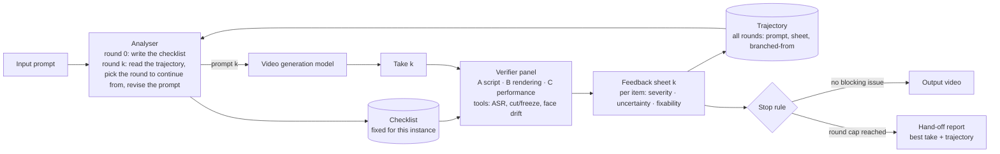

# LoopAuditor 实施计划

日期：2026-11-07。方法、数据和结果的完整说明见 `DESIGN.md`。
本文件只管两件事：把对齐后的设计写清楚，并给出逐模块的实施步骤。写代码前先看本文件，写完一个模块再回来对照。

状态标记：`[已定]` 用户已确认；`[待拍板]` 需要用户选；`[实施中]`；`[已验收]`。

---

## 0. 这份文件怎么用

1. 一次只做一个模块（§7）。做完跑 §8 的检查清单，用真实数据测一遍，把输入输出做成页面给用户看。用户确认后再开下一个。
2. 每个模块开工前，先把该模块的"目标"一段读一遍。做完后逐条对照。不一致的地方要么改代码，要么在 §12 记一笔"偏离 + 原因"。
3. 任何"先这样写，以后再改"的临时写法，都要在 §12 登记。没登记的临时写法视为 bug。
4. 本文件的英文术语就是代码里的命名。中文只是解释。

---

## 1. 项目定义与术语

**定义。** LoopAuditor 接在视频生成模型后面。它检查每一轮生成的视频，给每个问题打三个标签，改写 prompt，再生成，直到系统认为视频与 prompt 的预期一致。整个过程不需要人参与。

**为什么选短剧。** 视频生成目前跑得通的变现路径是短剧。短剧镜头有台词、动作、情绪三类明确要求，适合做检查。

**术语表。**

| 口语名 | 正式名（英文，即代码名） | 说明 |
|---|---|---|
| 整个系统 | **LoopAuditor**（Video-Generation Agentic Loop） | loop 是修饰词，核心是 verification harness；agentic 和 video generation 在副标题里 |
| analyser | **Analyser** | 一个 LLM，两种模式：开头编 checklist；每轮读轨迹、决定下一步 |
| checklist | **Checklist** | 本次实例要检查的全部条目。开头定下，循环中不改 |
| group of evaluation expert | **Verifier panel**；成员叫 **specialist verifier** | 三个专家按 §2 的三大类分工 |
| 一次生成的视频 | **take**（第 k 轮叫 round k，视频叫 take k） | |
| feedback sheet | **FeedbackSheet** | 每轮一张表：每个条目的三个标签、当前轮次 |
| 历史轨迹 | **Trajectory** | 全部轮次的 (prompt, feedback sheet, 从哪轮分出来)。按镜头持久化 |
| 三个标签 | **severity / uncertainty state / fixability** | 见 §5 |
| 什么时候结束 | **Stop rule** | 规则判断，不用模型 |
| 交人 | **Hand-off** | 尽量少走。目前只做最简分支（§4） |
| 三大维度 | **Script fidelity / Rendering integrity / Dramatic performance** `[待拍板]` | 见 §2 |

---

## 2. 评估维度体系 `[待拍板：类名与优先级]`

三大类各回答一个问题。每一类下面是具体检查项。每项有证据来源和默认优先级。

证据来源缩写：**T** = 确定性工具；**D** = 盲描述 + 文本判断（先让模型不带清单描述视频，再用文本判断条目是否成立）；**P** = 专家直接看听并回答；**T/P** = 工具为主、模型补充。

### A. Script fidelity（剧本忠实度）：视频有没有拍出 prompt 写的东西？

| 编号 | 检查项 | 问题 | 证据 | 默认优先级 |
|---|---|---|---|---|
| A1 | 台词逐字 | 台词是否用英语、完整、逐字说出 | T（ASR：转写、语言、WER） | critical |
| A2 | 动作完成 | 每个写明的动作是否发生、是否做完、顺序是否对 | D + P | critical |
| A3 | 要素齐全 | 写明的道具、场景、音效是否出现 | D + P（音效靠听） | major |
| A4 | 无多余内容 | 画面里的人是否都在 Analyser 从剧本定出的人物表里；是否只有说话人出声；有没有未写明的事件改变了场景 | D + P | critical（人物表外的人）/ major（其他） |
| A5 | 前提与关系逻辑 | 背景与人物关系是否符合剧情前提（例：围剿一个人的军队不该互相打） | D | major |
| A6 | 取景 | 镜头是否对准说话人、景别与竖屏是否符合 | T/P | minor |

关于"自由发挥"：checklist 分三部分。**MUST**（prompt 明写的）、**MUST NOT**（否定项和系统默认，例如不要字幕、只能一个人）、**PREMISE**（剧情前提的事实，例如"军队在围剿他"）。没写到的内容允许模型自由发挥，但不能违反 MUST NOT 和 PREMISE。军队互殴属于违反 PREMISE。

### B. Rendering integrity（成像完整性）：画面和声音本身有没有毛病？

| 编号 | 检查项 | 问题 | 证据 | 默认优先级 |
|---|---|---|---|---|
| B1 | 物理合理 | 液体、碰撞、重力是否正常 | P | minor；动作涉及物理时 Analyser 提到 major |
| B2 | 解剖与伪影 | 手、脸、肢体是否正常；物体是否变形；文字是否乱码 | P（必要时放大看） | major |
| B3 | 身份一致 | 同一张脸、同一个声音、同一套衣服贯穿全片 | T/P（人脸向量漂移 + 听） | major |
| B4 | 时间连续 | 有没有意外切镜、定格、跳帧、循环 | T（帧差）+ P | major |
| B5 | 音画同步 | 口型是否对上；音效是否对上事件；声音是否来自画面里的人 | P | major |
| B6 | 技术交付 | 时长、分辨率、比例、有无音轨 | T（ffprobe） | info，不符时 major |
| B7 | 画面文字 | 有没有字幕、水印 | P | minor |

### C. Dramatic performance（表演）：演得对不对？

| 编号 | 检查项 | 问题 | 证据 | 默认优先级 |
|---|---|---|---|---|
| C1 | 情绪类别 | 情绪是否与提示一致 | P | major |
| C2 | 情绪强度 | 强度是否落在目标区间；有没有演过了（AI 短剧常见的大惊小怪） | P（0–4 分，脸和声音各一个） | major |
| C3 | 情绪转折时机 | prompt 写了转折时，转折是否发生、时机是否对 | P | minor（只在写了转折时启用） |
| C4 | 台词表达 | 语速、停顿、语气是否符合括号提示 | P | minor |
| C5 | 氛围 | 光线、场景、基调是否与前提一致 | P | minor |
| C6 | 美学 | 构图、光线质量、意境 | P | info（只提示，不拦） |

---

## 3. 系统架构

和用户 11/07 手绘图的对应：input prompt → Analyser → checklist；Analyser → video generation model → generated video → group of evaluation expert（读 checklist）→ feedback & todo（跨轮次的记忆）→ 回到 Analyser。代码里把"feedback & todo"拆成两个对象：每轮一张 FeedbackSheet，全部轮次合起来是 Trajectory。图上仍画成一个框。



**两条规则，代码里强制。**

1. Verifier panel 看不到轨迹、看不到 Analyser 的改写理由、看不到上一轮的结论。它只拿到视频和 checklist。原因：Xu 2026（Don't Read the Log）发现看过日志的验证器会被污染。
2. Analyser 不能改剧本。台词、动作、音效这些原文片段必须原样留在新 prompt 里。只能增删"指导句"（例如 "speaks English"、"no other person in frame"）。代码用子串检查。

**Checklist 冻结。** checklist 在第 0 轮编好，循环中不改。这是对 Who Validates the Validators 里"标准漂移"的回应：漂移发生在评估标准随着看的样本变化。我们把标准锁在第 0 轮。checklist 模板本身在 30 镜头的人工审核后修订一次，然后冻结（§9）。

---

## 4. 循环机制 `[已定]`

**第 0 轮。** Analyser 读 prompt，写出 checklist：本次实例要求了什么、有哪些前提、系统默认有哪些否定项。每个条目映射到 §2 的一个编号。

**第 k 轮（k ≥ 1）。** Analyser 拿到整条轨迹：每一轮的 prompt、每一轮的 feedback sheet、每一轮是从哪一轮分出来的。它自己推理，输出四样东西：

1. `branch_from`：从哪一轮的 prompt 出发。可以是上一轮，也可以回到更早的某一轮（例如第 6 轮的 prompt 已经过度精细，就从第 3 轮重新分叉）。
2. `revised_prompt`：新 prompt。
3. `rationale`：为什么这样改、为什么从那一轮出发。写进轨迹。
4. `targets`：这次想修的条目编号。

规则层只做两件事：检查原文片段没被改；检查轮数没超上限。不给 Analyser 打分公式，不替它选父节点。它怎么搜索由它自己决定。轨迹保留全部分支，所以它随时可以回退。

**生成与检查。** 新 prompt 送生成模型，得到 take k。Verifier panel 对照 checklist 检查，产出 feedback sheet k（§5 的三个标签）。sheet 追加进轨迹。

**Stop rule `[已定；2026-11-08 修订]`。** 拦住输出的问题 = severity 为 error 且 uncertainty state 为 confident 或 uncertain。
- 没有这样的问题 → 输出视频。
- 有，且其中至少一个是 prompt_fixable 或 retry_fixable → 继续下一轮。
- 有，且全部是 backend_limited → 交人（hand-off），不放行。系统已经判定改 prompt 和重抽都修不好，这时放行就是把已知的错交付出去。
warning、info、not_observable 写进最终报告，不拦输出。

**轮数上限与交人。** 每个镜头最多 K 轮（K = 8）。到了上限还没通过，就停下，由 Analyser 从轨迹里指出它认为最好的一轮，连同整条轨迹一起输出为 hand-off 报告。这是目前唯一的交人分支。

**伪代码。**

```
checklist  = analyser.write_checklist(prompt)          # 之后不再改
trajectory = Trajectory(shot_id)                        # 落盘
prompt_k   = prompt
for k in range(K):
    take_k  = backend.generate(prompt_k)
    sheet_k = panel.verify(take_k, checklist)           # panel 看不到 trajectory
    trajectory.append(k, prompt_k, sheet_k, branched_from)
    if stop_rule(sheet_k):                              return Output(take_k, trajectory)
    plan     = analyser.revise(checklist, trajectory)   # branch_from, revised_prompt, rationale, targets
    assert_script_spans_unchanged(plan.revised_prompt)  # 规则 2
    prompt_k, branched_from = plan.revised_prompt, plan.branch_from
return HandOff(analyser.pick_best(trajectory), trajectory)
```

---

## 5. 三个标签（代码必须对齐的表）

**uncertainty state**（不问模型要概率）。输入是四个一致性信号：order_swap_agree、second_family_agree、tool_agree、visibility。

| 条件 | 状态 |
|---|---|
| 多数运行说 not_observable | not_observable |
| 有工具证据，且工具与多数模型一致 | confident |
| 没有工具证据，但顺序交换一致且第二家族一致 | confident |
| 其余 | uncertain |

uncertain 时允许一次 re-inspect（截取该时间段的帧和音频，只问这一条）。re-inspect 后若与多数一致则 confident，否则保持 uncertain。

**severity**

| status | priority | state | severity |
|---|---|---|---|
| fail | critical | confident 或 uncertain | error |
| fail | major | confident | error |
| fail | major | uncertain | warning |
| fail | minor | 任意 | warning |
| 任意 | 任意 | not_observable | info（标 unverified） |
| pass | 任意 | 任意 | info |

**fixability**。先查先验表（例如 A1 语言错误 → prompt_fixable；B2 手部伪影 → retry_fixable；B5 口型 → backend_limited）。再看轨迹：同一问题在 2 次改 prompt 后仍 fail → backend_limited；同一问题在轨迹里时好时坏 → retry_fixable。先验表由 30 镜头的试跑数据修订一次后冻结。

---

## 6. 生成与检查的模型 `[已定]`

- 时长 8 秒，竖屏 9:16，480p，开音频。
- 生成模型：bytedance/seedance-2.0（OpenRouter）。480p 带音频 $0.0673/秒，8 秒 $0.54。
- 预算：30 镜头 × 最多 8 轮 = 240 take 上限，约 $130；按平均 3 轮算约 $49。
- 检查模型：主 google/gemini-3.5-flash-lite；第二家族 qwen/qwen3.8-omni-flash。Analyser 用文本 LLM openai/gpt-5.6-luna（可换）。
- 工具：mlx-whisper（ASR）、ffprobe、帧差检测。

---

## 7. 模块化实施步骤

代码放在 `pj/loopauditor/loopauditor/`。总行数上限 3,000 行（包内，不含 scripts 和 tests）。每个模块给了预算。旧原型 `pj/avharness/avharness/` 约 1,500 行，可复用的部分写在"复用"一栏。

每个模块的交付物有三样：代码和测试；一次真实数据上的运行；一个页面（`docs/pages/<模块>.html`），左边输入、右边输出，给用户检查。

### M0 数据对象与基础设施（预算 400 行） `[已验收 2026-11-07]`
- **目标**：定义全部数据对象，一次定清楚，后面模块只用不改。
- **产出**：`schemas.py`（Checklist、ChecklistItem、Take、Observation、RawVerdict、Verdict、FeedbackSheet、Round、Trajectory、RevisionPlan、HandOffReport）、`config.py`（模型 id、价格、K、路径）、`cache.py`（按 sha(model, prompt, media) 缓存）、`cost.py`（从 `/generation` 读成本）。
- **关键规则**：ChecklistItem 带 `family`（A/B/C）、`check_id`（A1…C6）、`kind`（must / must_not / premise）、`priority`、`evidence`、`params`。优先级来自 §2 的表，不来自模型。FeedbackSheet 自带 `blocking()`，就是 §4 的 stop rule 条件。
- **复用**：旧 `schemas.py`（120 行）扩展；旧 `judge.py` 里的缓存逻辑抽出。
- **验收**：所有对象能 JSON 往返；手写的 DB-38 和 DB-16 checklist 能加载，原文片段检查通过；用 pilot 的真实 feedback 数据算 `blocking()`。
- **禁止**：字段给 `Optional` 默认值来掩盖缺失；`dict[str, Any]` 当正式数据结构。

### M1 Analyser：写 checklist（预算 300 行） `[自检通过 2026-11-07]`
- **目标**：把一条镜头数据编成 checklist。结构化字段走规则，自由文本走 LLM，最后规则校验。
- **输入 → 输出**：prompt set 的一行（prompt、prompt_raw、line、speaker_cue、parenthetical、sfx_cue、shot_scale、camera、negative_prompt、duration）→ `Checklist`。
- **关键规则**：(1) 台词 → A1，音效 → A3，单说话人 → A4，景别 → A6，情绪提示 → C1/C2，B 类默认全开：这些由规则生成。(2) 动作、道具、前提事实、隐含否定项由 LLM 抽取，每项必须映射到 §2 的 check_id。(3) 人物表由 Analyser 从剧本定：说话人加上剧本放进场景的其他人；A4 据此写成"画面里的人都在人物表里"和"只有说话人出声"。系统默认项写进 must_not：英语台词、竖屏、无字幕。(4) 校验：台词原文必须出现在 A1 的 params 中；条目数在 8–24 之间；冲突检测（例：动作句提到第二个人，与单说话人冲突）→ 记 `conflicts`，不自动解决。
- **复用**：旧 `contract.py`（165 行）。
- **验收**：30 个镜头全部编出来；用户抽看 10 份，记录漏项率和幻觉项率。两项都要 < 10%，否则改模板再跑。
- **禁止**：LLM 解析失败时静默丢条目；把所有优先级设成 major 了事；用 LLM 决定优先级。
- **实现说明（2026-11-07）**：Analyser 模型用 openai/gpt-5.6-luna（文本模型，30 条全部一次通过，每条约 $0.001；gemini-3.5-flash-lite 会改写原文片段，需要重试，且把被称呼的人当成在场的人）。LLM 只抽取动作、要素、在场的其他人、前提事实，每项带原文片段；片段不在原文里就带着原文各行重试，最多 3 次，仍失败就报错。动作句里出现另一性别的代词（如女说话人、动作句写 "He smashes the jade"）时，规则把"the man"记为在场的人。人物表 = 说话人 + 剧本放进场景的其他人（用户 11/07：短剧不必然只有一个人，人物由 Analyser 定）。A4.1 = 画面里的人都在人物表里；A4.2 = 只有说话人出声；A4.3 = 无未写明的事件。台词和括号提示不算动作。

### M2 生成后端（预算 150 行） `[自检通过 2026-11-07]`
- **目标**：调用 OpenRouter 视频接口，支持 seed 和时长，记录真实成本。
- **输入 → 输出**：prompt + 后端名 → `Take{path, backend, seed, duration, cost_usd, request_id, latency}`。
- **关键规则**：后端表先只放 seedance-2.0。轮询超时 10 分钟后报错。生成失败就抛异常，不重试、不伪造成功。
- **复用**：`scripts/gen_pilot5.py`（34 行）。
- **验收**：对 DB-38 生成一次，文件可播放，成本与 `/generation` 一致。
- **禁止**：文件缺失时返回"成功"；捕获所有异常后继续。

### M3 证据工具（预算 300 行） `[自检通过 2026-11-07]`
- **目标**：确定性工具，给 panel 提供模型之外的独立证据。
- **工具清单**：ffprobe（B6）；ASR（A1：转写、语言、WER）；帧差切镜/定格检测（B4）；人脸向量漂移（B3，可选，先做可行性）；盲描述（两家族各一次，不带 checklist，带时间戳）。
- **加工具的门槛**：(1) 大多数镜头的 checklist 里有这条；(2) 试跑中模型在这条上出过错；(3) M3 Mac 上 CPU 可以在 60 秒内跑完。三条都满足才加。SyncNet 暂不加。
- **复用**：旧 `asr.py`（97 行）、`preflight.py`（110 行）。
- **验收**：5 条 pilot 视频上，ASR 语言判断全对（两条中文）；切镜检测与人工一致。
- **禁止**：工具报错时返回 pass；工具缺失时跳过且不记录。

### M4 Verifier panel（预算 400 行） `[自检通过 2026-11-07]`
- **目标**：三个专家分别核对自己那一类条目。先盲描述，再对照 checklist，必要时放大再看。
- **输入 → 输出**：take + checklist + M3 的 observations → 每条目若干 `RawVerdict`。
- **流程**：(1) 读入共享的盲描述。(2) 专家 A/B/C 各拿到自己那部分 checklist 和视频，对每条给 status、visibility、证据时间段；C 类另给脸和声音 0–4 强度。(3) 主模型跑两遍（条目顺序交换），第二家族跑一遍。(4) A 类还用文本模型对盲描述做判断，作为独立证据。(5) 对 uncertain 的条目做一次 re-inspect：截取该时间段的帧（4 fps）和音频，只问这一条。
- **成本目标**：每个 take ≤ $0.05。
- **复用**：旧 `judge.py`（256 行）的调用与解析。
- **验收**：在 5 条 pilot 视频上，"she closes the door" 这类未发生动作不再被判 pass；每条 RawVerdict 带可核对的时间段。
- **禁止**：整份 checklist 塞进一个 prompt；panel 读轨迹；解析失败时默认 not_observable（必须重试一次，再失败记 tool_error）。

### M5 标签聚合 → FeedbackSheet（预算 150 行） `[自检通过 2026-11-07]`
- **目标**：把 RawVerdict 和工具证据合成每条目的三个标签，写成 `FeedbackSheet`。
- **关键规则**：严格按 §5 的三张表。先验表放在一个 yaml 文件里，不写死在代码里。
- **复用**：旧 `decide.py` 的 `aggregate`。
- **验收**：`tests/test_labels.py` 覆盖 §5 每一行；用 pilot 数据重新聚合，与人工预期一致。
- **禁止**：模型输出里的"confidence"数字参与计算。

### M6 Trajectory 存储（预算 120 行） `[自检通过 2026-11-07]`
- **目标**：按镜头持久化全部轮次，支持中断后继续。
- **产出**：`runs/<shot>/trajectory.json`（每轮：round、prompt、branched_from、rationale、targets、take 路径、sheet 路径、成本）+ `runs/<shot>/rounds/<k>/`（take、sheet、observations）。
- **提供**：`append()`、`rounds()`、`render_for_analyser()`（把整条轨迹排成 Analyser 能读的文本）。不提供打分、不提供选父节点。
- **验收**：中断后重新加载能继续；渲染文本包含每轮的 prompt 和 sheet。
- **禁止**：只放内存不落盘；用 pickle。

### M7 Analyser：读轨迹、改 prompt（预算 250 行） `[自检通过 2026-11-07]`
- **目标**：Analyser 读 checklist 和整条轨迹，自己决定从哪一轮出发、怎么改。
- **输入 → 输出**：checklist + trajectory → `RevisionPlan{branch_from, revised_prompt, rationale, targets}`。
- **关键规则**：规则层只校验两件事：原文片段仍在、轮数未超。校验失败就让 Analyser 重做一次，再失败报错。
- **复用**：旧 `feedback.py`（54 行）里的 keep/fix 列表写法。
- **验收**：对 DB-16（中文台词）生成的 prompt 含语言指导句且台词原样；对一条人工构造的"第 3 轮最好、第 5 轮更差"的轨迹，Analyser 的 rationale 能说明它选了哪一轮以及为什么。
- **禁止**：Analyser 改台词或动作；Analyser 直接判输出；没有轮数上限的循环。

### M8 循环运行器、stop rule、hand-off 与 CLI（预算 250 行） `[自检通过 2026-11-07]`
- **目标**：把 M1–M7 串成 §4 的伪代码。`loopauditor run --shot DB-16 --max-rounds 8`。
- **输出**：`Output` 或 `HandOffReport`，以及每镜头的 markdown 报告。
- **复用**：旧 `pipeline.py`、`cli.py`、`report.py`。
- **验收**：3 个镜头端到端跑通；人为造一个修不好的问题在 K 轮后触发 hand-off。
- **禁止**：stop rule 写在 LLM prompt 里；循环里 catch 异常继续。

### M9 评估工具（预算 250 行）
- **目标**：导出标注表、算指标、跑基线。
- **指标**：每条检查对人工的 precision/recall；按 uncertainty state 分组的准确率（confident 应高于 uncertain）；无谓重拍率；通过率随轮次的变化；hand-off 率；每个输出镜头的成本。
- **基线**：B0 单次 VLM 判定 + 直接改写、无轨迹（类似 VISTA）；B1 best-of-N，不反馈；B2 固定级联（旧原型的工作流，无 Analyser 改写）。
- **验收**：在同一批 take 上，三条基线与本系统的指标表能一键生成。

---

## 8. 每个模块的检查清单

做完一个模块，逐条过。任何一条不过，不开下一个模块。

1. 把 §7 里该模块的"目标"读一遍。代码做的事和目标一致吗？多做了什么？少做了什么？
2. 在真实数据上跑一次，看输出文件，做成页面。
3. 跑 `grep -n "except\|fallback\|default\|or {}\|or \[\]\|pass$" loopauditor/<module>.py`。每一处都要能说出理由。说不出的删掉。
4. 没有超过 60 行的函数。没有超过 400 行的文件。
5. 没有只用一次的抽象（基类、注册表、工厂）。
6. 坏输入会报明确的错误，不会变成 pass、None 或空列表。写一个这样的测试。
7. 行数在预算内。超了先删再加。
8. 每次模型调用都有缓存键和成本记录。
9. 用户确认后，在本文件该模块标 `[已验收]` 并写日期。

写法约定：
- 数据只用 pydantic 对象传递，每一步落盘为 JSON。
- 不写防御性代码。调用方给错了就报错。
- 不写"兼容老格式"。老数据用脚本转换一次。
- 注释写"为什么"，不写"做了什么"。
- 测试用录好的模型响应（fixtures），离线可跑。

---

## 9. 实验与评估（概要；详见 DESIGN.md §11）

- **checklist 审核**（M1 后）：用户看 10 份 checklist，记漏项率、幻觉项率。修一次模板后冻结。这是人工校准标准的唯一一次。
- **Eval (a) 验证器有效性**（M5 后）：从所有 take 中按 uncertainty state 分层抽 60 个，用户对 A1–A5、B2–B5、C1–C2 共 11 项打标（含"看不出"）。算每项 precision/recall，以及 confident 与 uncertain 的准确率差。
- **Eval (b) 闭环**（M8 后）：30 镜头，K = 8。报告通过率、hand-off 率、每输出镜头成本、轮次分布。与 B0/B1/B2 比较。

---

## 10. 待拍板决策（建议值在前）

1. 三大类的英文名：Script fidelity / Rendering integrity / Dramatic performance。备选：Prompt adherence / Perceptual integrity / Performance quality。
2. 人脸漂移工具（B3）：建议先花 10 分钟试可行性，不成就放弃。

---

## 11. Todo 与记录（本轮不做）

1. **15 秒**：用 DramaBench 同一说话人的两个连续节拍拼成原生 15 秒 prompt。seedance-2.0 支持 4–15 秒，480p 15 秒约 $1.01。先比 10 个镜头的 8 秒和 15 秒问题数。
2. **把搜索做得更明确**：节点得分 `score = Σ_{open issues} w(severity)·c(state)`（w: error 3 / warning 1 / info 0；c: confident 1 / uncertain 0.5）；默认父节点 = 得分最低且子节点 < 2；regression 的正式定义（父轮 pass、子轮 fail）、keep 句、翻转两次改 RETRY；regression rate 作为指标。
3. **换后端动作**（SWITCH）：backend_limited 的 error 触发换生成模型。
4. **更完整的交人设计**：停滞检测、交人报告格式、交人率作为指标。
5. **更细的评估**：user study、多个生成模型、prompt 规模从 30 扩到 90。
6. **两阶段检查**（先粗召回区间、再细查）是否比 re-inspect 更好：做消融。
7. **备选模型记录**（OpenRouter，2026-11-07 价格，480p 带音频每秒）：seedance-2.0-mini $0.034（4–15 秒）、seedance-2.0-fast $0.040、seedance-2.5 $0.103（到 30 秒）、veo-3.1-lite 只有 720p $0.05 且最长 8 秒、gemini-omni-1.2-flash 360p $0.023（3–15 秒，未试）。pilot 用的 seedance-1-5-pro 已不可用。

---

## 12. 变更记录

| 日期 | 模块 | 偏离或变更 | 原因 |
|---|---|---|---|
| 2026-11-07 | — | 建立本文件 | 设计对齐 |
| 2026-11-07 | — | K = 6 → 8；不做 Veo 跨后端小样 | 用户决定 |
| 2026-11-08 | M8 | stop rule 修订：全部拦截项都是 backend_limited 时交人，不放行（用户 11/08）。按新规则重算五条已跑完的轨迹：DB-38 输出；DB-16、DB-35、DB-60、SB-01 交人 | 用户决定 |
| 2026-11-08 | M8/M9 | 5 条镜头全部输出：平均 3.2 轮、$1.88/条，共 $9.40。DB-35、DB-60 的台词仍是中文，A1 两轮改写后转 backend_limited，按 stop rule 放行并报告。`scripts/loop_metrics.py` 出度量表 | 真实数据 |
| 2026-11-07 | M2 | /generation 的账单记录可能滞后超过 18 秒（DB-38 第二次运行因此中断）。改为最多等 90 秒；仍没有就用价目表估算并写 cost_estimated.json。续跑时若 take.mp4 已下载则直接复用，不再生成 | 真实数据 |
| 2026-11-07 | M2/M8 | 服务商事后拒绝输出（DB-38 第 0 轮："output audio may be related to copyright restrictions"）。generate() 仍然只抛异常；循环层对同一 prompt 重试一次，再拒就 hand-off，拒绝原因写进 handoff.json | 真实数据：生成是随机的，拒绝也是 |
| 2026-11-07 | M6–M8 | 端到端自检：DB-16 跑 5 轮后输出，$2.93；Analyser 三次从第 0 轮分叉，第 4 轮从第 3 轮分叉。两个 error（脸上的回忆、surprise 情绪）在两轮改写后转为 backend_limited，按 stop rule 不再拦输出，写进报告 | 真实数据 |
| 2026-11-07 | M0 | RawVerdict 加 `value` 字段（工具的数值，如 WER） | M5 需要 WER 算 deviation |
| 2026-11-07 | M2 | 自检通过：DB-38 一条 take，seedance-2.0 480p 8 秒，138 秒，$0.565；实际尺寸 496x864 | 真实数据 |
| 2026-11-07 | M3 | B6 的短边判断放宽到 ±10%（服务商把 480p 出成 496 px）；ASR 用 whisper-small-mlx | 真实数据 |
| 2026-11-07 | M4 | 盲描述两次 + 专家 9 次并行跑；re-inspect 并行 | 串行一次要 200 秒 |
| 2026-11-07 | M4/M5 | 自检通过：DB-38 pilot 视频上，专家组判出电话没出现、纸没散落、简历文字乱码；抽帧人工核对一致。原型当时全部判通过 | 真实数据 |
| 2026-11-07 | M1 | Analyser 模型从 gemini-3.5-flash-lite 换成 gpt-5.6-luna；去掉 LLM 抽取的 must_not（只是重复 A4 规则）；加代词规则 | 30 条试跑的结果 |
| 2026-11-07 | M0 | 行数预算 250 → 400（实际 399：schemas 271、config 50、cache 43、cost 34） | 11 个数据对象加校验器，250 行放不下；总上限 3,000 不变 |
