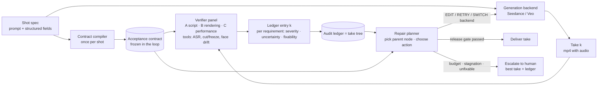

# 闭环审计器（verify–repair loop）实施计划 v3

日期：2026-11-07。上一版设计：`DESIGN_v2.md`（含附录 A）。本文件只管两件事：
把 11/07 对齐后的设计写清楚，并给出逐模块的实施步骤。写代码前先看本文件，写完一个模块再回来对照。

状态标记：`[已定]` 用户已确认；`[待拍板]` 需要用户选；`[实施中]`；`[已验收]`。

---

## 0. 这份文件怎么用

1. 一次只做一个模块（§7）。做完跑 §8 的验收清单，用户确认后再开下一个。
2. 每个模块开工前，先把该模块的"目标"一段读一遍。做完后逐条对照，不一致的地方要么改代码，要么在 §11 记一笔"偏离 + 原因"。
3. 任何"先这样写，以后再改"的临时写法，都要在 §11 登记。没登记的临时写法视为 bug。
4. 本文件的英文术语是代码里的命名。中文只是解释。

---

## 1. 项目定义与术语

**一句话定义。** 系统接在视频生成模型后面。它检查每一次生成的视频，给出带三个标签的问题清单，改写 prompt，再生成，直到放行或上报。整个过程不需要人参与。

**为什么选短剧。** 视频生成目前跑得通的变现路径是短剧。短剧镜头有台词、动作、情绪三类明确要求，适合做验收。

**命名对照表。** 口语名来自 11/07 的讨论。正式名用于论文、图和代码。

| 口语名 | 正式名（英文） | 说明 |
|---|---|---|
| 整个系统 | closed-loop audit-and-repair harness；循环叫 **verify–repair loop** | 系统名候选：RETAKE（影视里"重拍"）。用之前要查重。 |
| analyser（开头） | **Contract compiler** | 每个镜头只跑一次。输出验收合同。 |
| analyser（每轮） | **Repair planner** | 每轮读账本树，决定下一步。和 compiler 分开画、分开写。 |
| checklist | **Acceptance contract** | 一组原子的、可检查的要求。循环中冻结。 |
| group of evaluation expert | **Verifier panel**；成员叫 **specialist verifier** | 三个专家按 §2 的三大类分工。 |
| 一次生成的视频 | **take**（第 k 次叫 take k） | 影视术语，论文里自然。 |
| feedback sheet | **Audit ledger**；每轮一条 **ledger entry**；全部历史是 **take tree** | 账本按镜头持久化。树即搜索树。 |
| 三个标签 | **severity / uncertainty state / fixability** | 沿用 DESIGN_v2，见 §5。 |
| 什么时候结束 | **Release gate** | 规则判断，不用模型。 |
| 交人 | **Escalation**（escalate to human） | 独立的结果类型，有自己的指标。 |
| 三大维度 | **Script fidelity / Rendering integrity / Dramatic performance** | 见 §2。 |

---

## 2. 评估维度体系（条例化） `[待拍板：类名与优先级]`

三大类各回答一个问题。每一类下面是具体检查项。每项有证据来源和默认优先级。

证据来源缩写：**T** = 确定性工具；**D** = 盲描述 + 文本蕴含（先让模型不带清单描述视频，再用文本判断要求是否成立）；**P** = 专家直接看听并回答；**T/P** = 工具为主、模型补充。

### A. Script fidelity（剧本忠实度）：视频有没有拍出剧本写的东西？

| 编号 | 检查项 | 问题 | 证据 | 默认优先级 |
|---|---|---|---|---|
| A1 | 台词逐字 | 台词是否用英语、完整、逐字说出 | T（ASR：转写、语言、WER） | critical |
| A2 | 动作完成 | 每个写明的动作是否发生、是否做完、顺序是否对 | D + P | critical |
| A3 | 要素齐全 | 写明的道具、场景、音效是否出现 | D + P（音效靠听） | major |
| A4 | 无多余内容 | 是否只有一个说话人；有没有未写明的人物或事件改变了场景 | D + P | critical（第二个人）/ major（其他） |
| A5 | 前提与关系逻辑 | 背景与人物关系是否符合剧本前提（例：围剿一个人的军队不该互相打） | D（对前提事实做蕴含） | major |
| A6 | 取景 | 镜头是否对准说话人、景别与竖屏是否符合 | T/P（人脸框占比） | minor |

关于"自由发挥"：合同分三部分。**MUST**（剧本明写的）、**MUST NOT**（否定项和系统默认，例如不要字幕、只能一个人）、**PREMISE**（剧本前提的事实，例如"军队在围剿他"）。没写到的内容允许模型自由发挥，但不能违反 MUST NOT 和 PREMISE。军队互殴属于违反 PREMISE。

### B. Rendering integrity（成像完整性）：画面和声音本身有没有毛病？

| 编号 | 检查项 | 问题 | 证据 | 默认优先级 |
|---|---|---|---|---|
| B1 | 物理合理 | 液体、碰撞、重力是否正常 | P | minor；剧本动作涉及物理时 compiler 提到 major |
| B2 | 解剖与伪影 | 手、脸、肢体是否正常；物体是否变形 | P（必要时放大看） | major |
| B3 | 身份一致 | 同一张脸、同一个声音、同一套衣服贯穿全片 | T/P（人脸向量漂移 + 听） | major |
| B4 | 时间连续 | 有没有意外切镜、定格、跳帧、循环 | T（帧差）+ P | major |
| B5 | 音画同步 | 口型是否对上；音效是否对上事件；声音是否来自画面里的人 | P（SyncNet 待定） | major |
| B6 | 技术交付 | 时长、分辨率、比例、有无音轨 | T（ffprobe） | info，不符时 major |
| B7 | 画面文字 | 有没有字幕、水印、乱码文字 | P | minor |

### C. Dramatic performance（表演）：演得对不对？

| 编号 | 检查项 | 问题 | 证据 | 默认优先级 |
|---|---|---|---|---|
| C1 | 情绪类别 | 情绪是否与提示一致 | P | major |
| C2 | 情绪强度 | 强度是否落在目标区间；有没有演过了 | P（0–4 分，脸和声音各一个） | major |
| C3 | 情绪转折时机 | 剧本写了转折时，转折是否发生、时机是否对 | P | minor（只在写了转折时启用） |
| C4 | 台词表达 | 语速、停顿、语气是否符合括号提示 | P | minor |
| C5 | 氛围 | 光线、场景、基调是否与前提一致 | P | minor |
| C6 | 美学 | 构图、光线质量 | P | info（只提示，不拦） |

### G. 内容安全（横切门，不是维度）

不安全内容直接上报，不进循环。

与之前 14 + 5 维度的对应：A1–A6、B2–B5、C1–C3 是原 14 项核心；B1、B6、B7、C5、C6 是原 5 项扩展。原"预检 5 项"并入 B4、B6。

---

## 3. 系统架构



**两堵墙。** 这两条是硬规则，代码里要有断言。

1. Verifier panel 看不到账本、看不到 planner 的改写理由、看不到上一轮的结论。它只拿到视频和合同。原因：Xu 2026（Don't Read the Log）发现看过日志的验证器会被污染。
2. Repair planner 不能改剧本。台词、动作、音效这些 verbatim 片段必须原样留在新 prompt 里。只能增删"指导句"（例如 "speaks English"、"no other person in frame"）。代码用子串检查强制执行。原因：防止 planner 为了通过检查而偷偷改简单剧本。

**合同冻结。** 合同在循环开始时编好，循环中不改。这是对 Who Validates the Validators 里"标准漂移"的回应：漂移发生在评估标准随着看的样本变化。我们把标准锁在第 0 轮。合同模板本身在 30 镜头的人工审核后修订一次，然后冻结（见 §9）。

**画图建议。** 合同放上方横轨，表示全程不变。账本画成一棵小树，节点标 take 1…k，最优路径加粗。Panel 和账本之间画一堵墙。Planner 的三个出口（继续、放行、上报）分别用不同箭头。

---

## 4. 把循环写成搜索问题

**节点** `Node = (prompt, backend, seed, parent, keep_list)`。根节点是原始 prompt。
**取样** 对一个节点生成一次，得到 take 和 `LedgerEntry`（每条要求一行：status、三个标签、证据片段、成本）。
**得分** `score(node) = Σ_{open issues} w(severity) · c(state)`，其中 w(error)=3，w(warning)=1，w(info)=0；c(confident)=1，c(uncertain)=0.5。越低越好。
**动作**（planner 可选）：

| 动作 | 含义 | 什么时候合适 |
|---|---|---|
| EDIT(parent, clauses) | 在 parent 的 prompt 上增删指导句，生成子节点 | 问题 fixability = prompt_fixable |
| RETRY(parent) | 同一 prompt 换 seed | fixability = retry_fixable，或同一问题反复翻转 |
| SWITCH(parent, backend) | 同一 prompt 换生成模型 | fixability = backend_limited 且还有别的后端 |
| ACCEPT(node) | 放行 | release gate 通过 |
| ESCALATE(best) | 上报 | §4 终止条件 |

**选父节点。** 默认选得分最低、子节点数 < 2 的节点。planner 可以改选，但必须写明理由，理由进账本。这就是"回退"：当第 6 轮 prompt 已经过度精细，planner 可以从第 3 轮分叉。

**放行门（release gate）** `[已定，用户 11/07]`：账本里没有同时满足以下三条的问题，才能放行。
severity = error；uncertainty state ∈ {confident, uncertain}；fixability ∈ {prompt_fixable, retry_fixable}。
补充规则 `[待拍板]`：fixability = backend_limited 的 error 不拦放行，但触发 SWITCH；没有别的后端时触发上报。warning 只报告，不触发重拍。

**终止与上报条件。** 命中任一条就上报，上报内容是得分最低的 take、整棵树、试过的改法、仍未解决的问题。

1. 预算：takes ≥ K（默认 6）或该镜头花费超过上限。
2. 停滞：连续 2 次扩展后最低分没有下降，且没有可换的父节点。
3. 无法修：backend_limited 的 error 且没有别的后端。
4. 安全门失败。

**"按了葫芦起了瓢"。** 定义 **regression**：某条要求在父节点 pass、在子节点 fail。处理规则：
- 一旦 regression，这条要求进子节点的 keep_list，EDIT 时写成 KEEP 句。
- 同一条要求在树里翻转 ≥ 2 次，标记 retry_sensitive，fixability 改为 retry_fixable，之后优先 RETRY 而不是 EDIT。
- 指标：regression rate = 有 regression 的扩展数 / 总扩展数。这是论文里要报告的数字，而不只是风险。

**伪代码。**

```
contract = compile(shot)                     # 之后不再改
tree = Tree(root=Node(prompt=shot.prompt, backend=b0))
node = tree.root
while True:
    take  = backend.generate(node)
    entry = panel.verify(take, contract)     # panel 看不到 tree
    tree.record(node, entry)
    if gate.passes(entry):                   return Deliver(node)
    if reason := gate.should_escalate(tree): return Escalate(tree.best(), reason)
    node = planner.next_node(tree, contract) # EDIT / RETRY / SWITCH；规则层校验 prompt 不变量和预算
```

---

## 5. 三个标签（沿用 DESIGN_v2，这里是代码必须对齐的表）

**uncertainty state**（不问模型要概率）。输入是四个一致性信号：order_swap_agree、second_family_agree、tool_agree、visibility。

| 条件 | 状态 |
|---|---|
| 多数运行说 not_observable | not_observable |
| 有工具证据，且工具与多数模型一致 | confident |
| 没有工具证据，但顺序交换一致且第二家族一致 | confident |
| 其余 | uncertain |

uncertain 时允许一次 re-inspect（放大看、只问这一条）。re-inspect 后若与多数一致则 confident，否则保持 uncertain。

**severity**

| status | priority | state | severity |
|---|---|---|---|
| fail | critical | confident 或 uncertain | error |
| fail | major | confident | error |
| fail | major | uncertain | warning |
| fail | minor | 任意 | warning |
| 任意 | 任意 | not_observable | info（标 unverified） |
| pass | 任意 | 任意 | info |

**fixability**。先查先验表（例如 A1 语言错误 → prompt_fixable；B2 手部伪影 → retry_fixable；B5 口型 → backend_limited）。再看账本：同一问题在 2 次 EDIT 后仍 fail → backend_limited；翻转 ≥ 2 次 → retry_fixable。先验表由 30 镜头的试跑数据修订一次后冻结。

---

## 6. 时长与后端 `[待拍板]`（OpenRouter 数据，2026-11-07 核实）

| 模型 | 可选时长（秒） | 480p 带音频 $/秒 | 8 秒 | 12 秒 | 15 秒 | 备注 |
|---|---|---|---|---|---|---|
| bytedance/seedance-1-5-pro | 4–12 | 0.0231 | 0.18 | 0.28 | 不支持 | **2026-11-11 下线** |
| bytedance/seedance-2.0-mini | 4–15 | 0.0336 | 0.27 | 0.40 | 0.50 | 720p 为 0.0756 $/秒 |
| bytedance/seedance-2.0-fast | 4–15 | 0.0404 | 0.32 | 0.48 | 0.61 | |
| bytedance/seedance-2.0 | 4–15 | 0.0673 | 0.54 | 0.81 | 1.01 | |
| bytedance/seedance-2.5 | 4–30 | 0.1028 | 0.82 | 1.23 | 1.54 | |
| google/veo-3.1-lite | 4 / 6 / 8 | 只有 720p：0.05 | 0.40 | 不支持 | 不支持 | |
| google/gemini-omni-1.2-flash | 3–15 | 360p：0.0232；720p：0.1014 | 0.19（360p） | 0.28 | 0.35 | 新模型，未试 |

结论：
- 15 秒单镜头只有 Seedance 2.x 和 Gemini Omni 支持。Veo 最长 8 秒。
- Seedance 1.5 Pro 四天后下线，必须换。480p 下最便宜的替代是 seedance-2.0-mini。
- 预算：30 镜头 × 最多 5 take = 150 take。8 秒 480p mini 约 $40；15 秒 480p mini 约 $76。剩余额度约 $196。
- 建议：先做一次小对照（§9 的 E0）。10 个镜头，各生成一次 8 秒和一次 15 秒。15 秒版用 DramaBench 同一说话人的两个连续节拍（动作 + 台词 + 动作 + 台词）。比较每个 take 的问题数和账本长度。用数据定主实验用 8 还是 12/15 秒。
- 跨后端比较只能在 8 秒做，因为 Veo 没有更长的。

---

## 7. 模块化实施步骤

总行数上限 3,000 行（`avharness/` 包内，不含 scripts 和 tests）。每个模块给了预算。现有原型 1,500 行，可复用的部分在"复用"一栏。

### M0 数据对象与基础设施（预算 250 行）
- **目标**：定义 v3 的全部数据对象，一次定清楚，后面模块只用不改。
- **输入 → 输出**：无运行时输入。产出 `schemas.py`（Contract、Requirement、Take、RawVerdict、Verdict、LedgerEntry、Node、Action、EscalationPackage）、`config.py`（模型 id、价格、预算常量）、`cache.py`（按 sha(model, prompt, media) 缓存）、`cost.py`（从 `/generation` 读成本）。
- **关键规则**：Requirement 带 `family`（A/B/C）、`check_id`（A1…C6）、`priority`、`evidence`、`params`。优先级来自 §2 的表，不来自模型。
- **复用**：现有 `schemas.py`（120 行）扩展；`judge.py` 里的缓存逻辑抽出。
- **验收**：所有对象能 JSON 往返；一份手写的 DB-38 合同能加载。
- **禁止**：字段给 `Optional` 默认值来掩盖缺失；`dict[str, Any]` 当正式数据结构。

### M1 Contract compiler（预算 300 行）
- **目标**：把一条镜头数据编成验收合同。结构化字段走规则，自由文本走 LLM，最后规则校验。
- **输入 → 输出**：prompt set 的一行（prompt、prompt_raw、line、speaker_cue、parenthetical、sfx_cue、shot_scale、camera、negative_prompt、duration）→ `Contract{must, must_not, premise, requirements}`。
- **关键规则**：(1) 台词 → A1，音效 → A3，单说话人 → A4，景别 → A6，情绪提示 → C1/C2，B 类默认全开：这些由规则生成。(2) 动作、道具、前提事实、隐含否定项由文本 LLM 抽取，每项必须映射到 §2 的 check_id。(3) 系统默认项写进 must_not：英语台词、单说话人、竖屏、无字幕。(4) 校验：台词原文必须出现在 A1 的 params 中；要求数在 6–16 之间；冲突检测（例：动作句提到第二个人，与单说话人冲突）→ 记 `contract_conflict`，不自动解决。
- **复用**：`contract.py`（165 行）。
- **验收**：30 个镜头全部编译；用户抽看 10 份，记录漏项率和幻觉项率。两项都要 < 10%，否则改模板再跑。
- **禁止**：LLM 解析失败时静默丢要求；把所有优先级设成 major 了事；用 LLM 决定优先级。

### M2 生成后端适配（预算 150 行）
- **目标**：统一调用 OpenRouter 视频接口，支持多个后端、seed、时长，记录真实成本。
- **输入 → 输出**：`Node` → `Take{path, backend, seed, duration, cost_usd, request_id, latency}`。
- **关键规则**：后端表只放 seedance-2.0-mini、veo-3.1-lite（可加）。轮询超时 10 分钟后报错。生成失败就抛异常，不重试、不伪造成功。
- **复用**：`scripts/gen_pilot5.py`（34 行）。
- **验收**：对 DB-38 用两个后端各生成一次，文件可播放，成本与 `/generation` 一致。
- **禁止**：文件缺失时返回"成功"；捕获所有异常后继续。

### M3 证据工具（预算 300 行）
- **目标**：确定性工具，给 panel 提供模型之外的第三票。
- **工具清单**：ffprobe（B6）；ASR（A1：转写、语言、WER）；帧差切镜/定格检测（B4）；人脸向量漂移（B3，可选，先做可行性）；盲描述（两家族各一次，不带合同，带时间戳）。
- **输入 → 输出**：take → 若干 `Observation{source, status, evidence, cost}`。
- **加工具的门槛**：(1) 大多数镜头的合同里有这条检查；(2) 试跑中模型在这条上出过错；(3) M3 Mac 上 CPU 可以在 60 秒内跑完。三条都满足才加。SyncNet 暂不加，等 B5 的试跑数据。
- **复用**：`asr.py`（97 行）、`preflight.py`（110 行）。
- **验收**：5 条 pilot 视频上，ASR 语言判断全对（两条中文）；切镜检测对人工标注一致。
- **禁止**：工具报错时返回 pass；工具缺失时跳过且不记录。

### M4 Verifier panel（预算 400 行）
- **目标**：三个专家分别核对自己那一类要求。先盲描述，再对照合同，必要时放大再看。
- **输入 → 输出**：take + contract + M3 的 observations → 每条要求若干 `RawVerdict`。
- **流程**：(1) 读入共享的盲描述。(2) 专家 A/B/C 各拿到自己那部分合同和视频，对每条给 status、visibility、证据时间段；C 类另给脸和声音 0–4 强度。(3) 主模型跑两遍（要求顺序交换），第二家族跑一遍。(4) A 类还用文本模型对盲描述做蕴含，作为独立证据。(5) 对 uncertain 的条目做一次 re-inspect：截取该时间段的帧（4 fps）和音频，只问这一条。
- **模型**：主 google/gemini-3.5-flash-lite；第二家族 qwen/qwen3.8-omni-flash。
- **成本目标**：每个 take ≤ $0.05。
- **复用**：`judge.py`（256 行）的调用与解析。
- **验收**：在 5 条 pilot 视频上，"she closes the door" 这类未发生动作不再被判 pass（11/07 发现的问题）；每条 RawVerdict 带可核对的时间段。
- **禁止**：整份合同塞进一个 prompt；panel 读账本；解析失败时默认 not_observable（必须重试一次，再失败记 tool_error）。

### M5 标签聚合（预算 150 行）
- **目标**：把 RawVerdict 和工具证据合成每条要求的三个标签，写成 `LedgerEntry`。
- **关键规则**：严格按 §5 的三张表。先验表放在一个 yaml 文件里，不写死在代码里。
- **复用**：`decide.py` 的 `aggregate`（284 行里的一部分）。
- **验收**：`tests/test_labels.py` 覆盖 §5 每一行；用 pilot 数据重新聚合，与人工预期一致。
- **禁止**：模型输出里的"confidence"数字参与计算。

### M6 账本与搜索树（预算 150 行）
- **目标**：按镜头持久化全部节点与 entry，支持重放和回退。
- **输入 → 输出**：`runs/<shot>/tree.json` + `entries/<node_id>.json`。提供 `best()`、`frontier()`、`regressions(node)`、`flip_count(req_id)`。
- **验收**：中断后重新加载能继续；得分与 §4 公式一致。
- **禁止**：树放内存不落盘；用 pickle。

### M7 Repair planner（预算 300 行）
- **目标**：读树和合同，选父节点和动作，生成新 prompt；规则层校验。
- **流程**：(1) 规则层给默认父节点（最低分、未扩满）。(2) 文本 LLM 看到：合同、树的摘要（每个节点的分数、开放问题、用过的改法）、默认父节点。它输出：父节点、动作、改动的指导句、理由。(3) 规则层校验：verbatim 片段仍在；只改指导句；预算未超；动作与 fixability 匹配。校验失败就退回默认动作，并记录。
- **复用**：`feedback.py`（54 行）。
- **验收**：对 DB-16（中文台词）生成的 EDIT 含语言指导句且台词原样；对一个人工构造的"翻转两次"树，planner 选 RETRY。
- **禁止**：planner 改台词或动作；planner 直接判放行；没有预算上限的循环。

### M8 循环运行器、放行门、上报与 CLI（预算 250 行）
- **目标**：把 M1–M7 串成 §4 的伪代码。`avharness loop --shot DB-16 --backend seedance-2.0-mini --max-takes 6`。
- **输出**：`Deliver` 或 `EscalationPackage`，以及每镜头的 markdown 报告。
- **复用**：`pipeline.py`、`cli.py`、`report.py`。
- **验收**：3 个镜头端到端跑通；人为造一个不可修问题（例如要求 15 秒但后端只给 8 秒）触发上报。
- **禁止**：放行条件写在 LLM prompt 里；循环里 catch 异常继续。

### M9 评估工具（预算 250 行）
- **目标**：导出标注表、算指标、跑基线。
- **指标**：每条检查对人工的 precision/recall；按 uncertainty state 分组的准确率（confident 应高于 uncertain）；无谓重拍率；放行率随 take 序号的变化；上报率；regression rate；每个放行镜头的成本。
- **基线**：B0 单次 VLM 判定 + 直接改写、无账本（类似 VISTA）；B1 best-of-N，不反馈；B2 固定级联（DESIGN_v2 的工作流，无 planner、无树）。
- **验收**：在同一批 take 上，三条基线与本系统的指标表能一键生成。

---

## 8. 每个模块的验收清单（防偷懒、防屎山）

做完一个模块，逐条过。任何一条不过，不开下一个模块。

1. 把 §7 里该模块的"目标"读一遍。代码做的事和目标一致吗？多做了什么？少做了什么？
2. 在两条真实视频上跑一次，看输出文件。
3. 跑 `grep -n "except\|fallback\|default\|or {}\|or \[\]\|pass$" avharness/<module>.py`。每一处都要能说出理由。说不出的删掉。
4. 没有超过 60 行的函数。没有超过 400 行的文件。
5. 没有只用一次的抽象（基类、注册表、工厂）。后端表除外。
6. 坏输入会报明确的错误，不会变成 pass、None 或空列表。写一个这样的测试。
7. 行数在预算内。超了先删再加。
8. 每次模型调用都有缓存键和成本记录。
9. 用户确认后，在本文件该模块标 `[已验收]` 并写日期。

写法约定：
- 数据只用 pydantic 对象传递，每一步落盘为 JSON。
- 不写防御性代码。调用方给错了就报错。
- 不写"兼容老格式"。老数据用脚本转换一次。
- 注释写"为什么"，不写"做了什么"。
- 测试用录好的模型响应（fixtures），离线可跑。

---

## 9. 实验与评估（概要；指标定义见 DESIGN_v2 §7，按本文件更新）

- **E0 时长对照**（M2 后即可）：10 镜头 × {8 秒, 15 秒两节拍} × 1 take。看每 take 问题数、A/B/C 三类分布。决定主实验时长。
- **合同审核**（M1 后）：用户看 10 份合同，记漏项率、幻觉项率。修一次模板后冻结。这是人工校准标准的唯一一次。
- **Eval (a) 验证器有效性**（M5 后）：从所有 take 中按 uncertainty state 分层抽 60 个，用户对 A1–A5、B2–B5、C1–C2 共 11 项打标（含"看不出"）。算每项 precision/recall，以及 confident 与 uncertain 的准确率差。
- **Eval (b) 闭环**（M8 后）：30 镜头，K = 6，seedance-2.0-mini 480p。报告放行率、上报率、regression rate、每放行镜头成本。与 B0/B1/B2 比较。
- **可选**：Veo 8 秒的跨后端小样；最终 take 的两两人工偏好（用户 + 1–2 位同学）。

---

## 10. 待拍板决策（建议值在前）

1. 三大类的英文名：Script fidelity / Rendering integrity / Dramatic performance。备选：Prompt adherence / Perceptual integrity / Performance quality。
2. 时长：先跑 E0 再定；若不想跑，建议主实验 8 秒（可跨后端），加一组 12 秒 Seedance 扩展。
3. 生成后端：seedance-2.0-mini 480p 替代 1.5 Pro。
4. backend_limited 的 error：不拦放行但触发 SWITCH / 上报（§4）。
5. warning 不触发重拍，只进报告。
6. 预算 K = 6 个 take / 镜头，停滞耐心 2。
7. 合同冲突（动作句含第二个人）：数据层剔除，还是改成 "second person stays off-camera" 的 PREMISE？建议后者，这样 DB-35 这类镜头保留。
8. 系统名 RETAKE 是否采用（需查重）。
9. 人脸漂移工具（B3）是否进 M3，还是等试跑数据。建议先做可行性，10 分钟内不成就放弃。

---

## 11. 变更记录

| 日期 | 模块 | 偏离或变更 | 原因 |
|---|---|---|---|
| 2026-11-07 | — | 建立本文件 | 11/07 设计对齐 |
